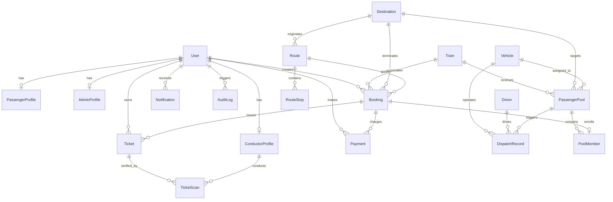

# RAILBUS — Database Schema & Entity Relationships

The database is managed with **Prisma ORM**, configured for PostgreSQL or portable SQLite zero-config persistence.

---

## Entity Details

| Table | Primary Key | Key Foreign Keys | Purpose |
|---|---|---|---|
| `User` | `id` (UUID) | None | Universal identity with `role` (`PASSENGER`, `ADMIN`, `CONDUCTOR`) and `passwordHash` |
| `PassengerProfile` | `id` (UUID) | `userId` | Commuter preferences, emergency contact |
| `AdminProfile` | `id` (UUID) | `userId` | Operations department, access level (`SUPER_ADMIN`) |
| `ConductorProfile`| `id` (UUID) | `userId` | Employee ID, badge number, assigned bus ID |
| `Train` | `id` (UUID) | None | Mysuru inbound trains, arrival telemetry, platform, delay minutes |
| `Destination` | `id` (UUID) | None | Mysuru city drop-off corridors, base fare, GPS coordinates |
| `Route` | `id` (UUID) | `destinationId` | Route name, total distance (km), transit duration |
| `RouteStop` | `id` (UUID) | `routeId` | Stop name, order, latitude/longitude, arrival offset minutes |
| `Vehicle` | `id` (UUID) | None | KSRTC fleet buses, capacity (56), status, depot |
| `Driver` | `id` (UUID) | None | Driver name, phone, license number, status |
| `PassengerPool` | `id` (UUID) | `trainId`, `destinationId`, `assignedVehicleId` | Aggregated demand (20–56 passengers), status (`FORMING`, `ELIGIBLE_FOR_REVIEW`, `APPROVED`, `FULL`, `DISPATCHED`) |
| `Booking` | `id` (UUID) | `passengerId`, `trainId`, `destinationId`, `poolId` | Passenger reservation, fare, payment status |
| `Payment` | `id` (UUID) | `bookingId`, `passengerId` | Amount, currency, gateway (`RAZORPAY`, `TEST_MOCK`), order ID |
| `Ticket` | `id` (UUID) | `bookingId`, `passengerId` | QR token, 6-digit verification code, boarding status |
| `TicketScan` | `id` (UUID) | `ticketId`, `conductorId` | Atomic scan logs, scan method, result (`SUCCESS`, `DUPLICATE`, `EXPIRED`) |
| `DispatchRecord` | `id` (UUID) | `poolId`, `vehicleId`, `driverId` | Staged bus dispatch, bay number, departure status |
